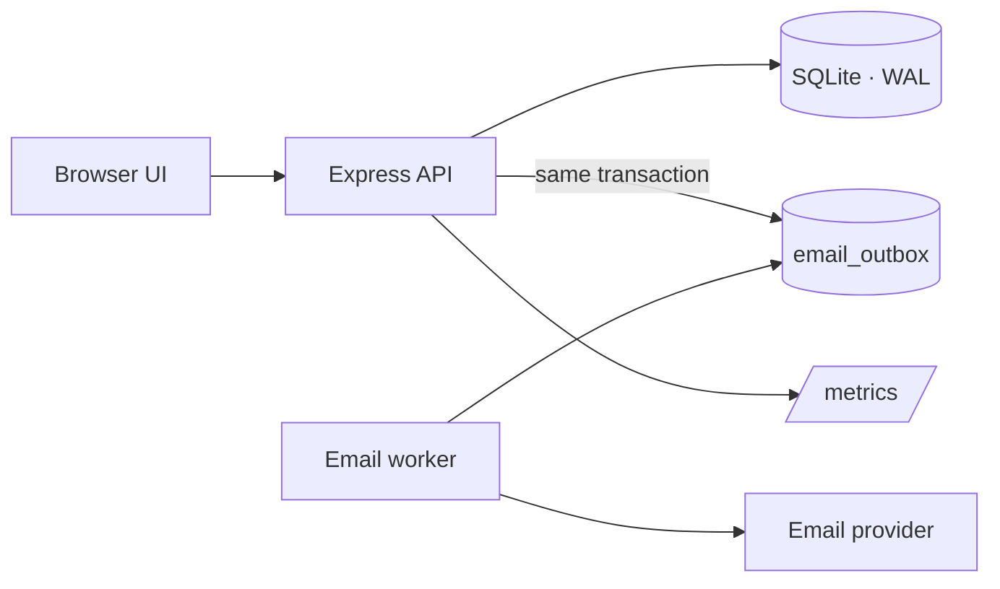

# schedulr

A Calendly-style booking service. Hosts publish availability, guests book open slots, and
confirmation emails are delivered asynchronously through a durable outbox.

Built with **TypeScript**, **Express 5**, and **SQLite** (`node:sqlite`), with a dependency-free
browser UI and a live "scenario lab" for exercising the system.

## Highlights

- **Correct under concurrency** — booking claims a slot atomically in a transaction; one slot can
  never be booked twice, even across multiple server processes.
- **Idempotent bookings** — send an `Idempotency-Key` and retries return the original booking.
- **Durable email delivery** — bookings and email rows are written in the same transaction; a
  bounded worker retries with exponential backoff and dead-letters after 5 attempts.
- **Host authentication** — host endpoints require an API key; guest data is never publicly
  readable.
- **Input validation** with clear `4xx` responses, field/body limits, and no stack-trace leaks.
- **Operational readiness** — structured JSON logs with request IDs, Prometheus metrics, health
  and readiness probes, graceful shutdown, rate limiting, and request timeouts.
- **Performance** — shared SQLite connection with WAL, availability caching, keyset pagination,
  gzip compression, and keep-alive tuning.
- **Repeatable load testing** — a two-process mixed-load harness with correctness invariants and
  latency percentiles.

## Architecture



```
src/
  app.ts          Express composition + routes
  booking.ts      atomic booking transaction
  outbox.ts       durable email queue worker
  idempotency.ts  request fingerprints + replay
  db.ts           shared connection, WAL, busy retry
  migrations.ts   versioned schema
  auth.ts         host API-key authentication
  validation.ts   request parsing + limits
  pagination.ts   offset + keyset cursors
  cache.ts        TTL cache
  rateLimit.ts    per-IP, per-route limiter
  compression.ts  gzip responses
  config.ts       validated configuration
  logger.ts       structured logging + redaction
  metrics.ts      Prometheus registry
  http.ts         request ids, timeouts, errors
public/           browser UI, scenario lab, worker dashboard, API docs
docs/             API reference, backup runbook, Postgres plan, build log
scripts/          load test, backup CLI
tests/            unit + integration tests
```

## Quick start

Requires Node 22+ (Node 24 recommended).

```bash
npm install
npm run dev
```

Open **http://127.0.0.1:8080**.

In development, host credentials default to `<host>-key` (for `alice`, `bob`, `carol`, `dave`,
`dup`). To set your own:

```bash
HOST_API_KEYS="alice:alice-key,bob:bob-key" npm run dev
```

### Pages

| Page | URL | Purpose |
|---|---|---|
| Booking app | `/` | Create slots, browse availability, book, view bookings |
| Email worker | `/outbox.html` | Live outbox table, worker metrics, batch generation |
| Scenario lab | `/lab.html` | Runs every fixed bug + production-readiness check live |
| API docs | `/api-docs` | Browsable operations from the OpenAPI spec |
| OpenAPI spec | `/openapi.json` | Machine-readable spec |

## API

Host endpoints require `Authorization: Bearer <key>` (or `X-Api-Key: <key>`). Guest endpoints are
public.

| Method | Path | Auth | Description |
|---|---|---|---|
| `POST` | `/slots` | host | Create an availability slot |
| `GET` | `/availability/{host}` | — | List a host's open slots |
| `POST` | `/book` | — | Book a slot (optional `Idempotency-Key`) |
| `GET` | `/bookings/{host}` | host | List a host's bookings |
| `GET` | `/outbox` | host | Inspect the email outbox and worker state |
| `GET` | `/healthz` · `/readyz` | — | Liveness · readiness |
| `GET` | `/config` · `/metrics` | — | Non-secret config · Prometheus metrics |

See **[docs/api.md](docs/api.md)** for the full reference (auth, status codes, pagination,
idempotency, rate limiting, examples). The OpenAPI spec lives in
**[docs/openapi.yaml](docs/openapi.yaml)** and is served at `/openapi.json`.

## Configuration

| Variable | Default | Purpose |
|---|---|---|
| `PORT` | `8080` | Listen port |
| `DB_PATH` | `schedulr.db` | SQLite database file |
| `HOST_API_KEYS` | dev defaults | `name:key,name:key` host credentials |
| `EMAIL_LATENCY_MS` | `300` | Simulated email latency |
| `EMAIL_FAILURE_RATE` | `0.05` | Simulated email failure rate (0–1) |
| `RATE_LIMIT_MAX` | `1000` | Requests per window per IP + route |
| `RATE_LIMIT_WINDOW_MS` | `60000` | Rate-limit window |
| `AVAILABILITY_CACHE_TTL_MS` | `2000` | Availability cache TTL (`0` disables) |
| `COMPRESSION_THRESHOLD_BYTES` | `1024` | Minimum size to gzip |
| `REQUEST_TIMEOUT_MS` | `10000` | Request timeout |
| `BODY_LIMIT` | `16kb` | Max JSON body size |
| `LOG_LEVEL` | `info` | `debug` / `info` / `warn` / `error` |

## Developing

```bash
npm test              # unit + integration tests
npm run typecheck     # tsc --noEmit
npm run dev           # local server with watch-free tsx
npm run loadtest      # two-process mixed-load harness + invariants
npm run backup -- <destination.db>
```

The load harness spawns **two** server processes on one SQLite file, drives a deterministic mixed
workload, and asserts invariants (no double bookings, no stranded slots, drained outbox, zero
5xx). It also reports client/server latency percentiles, throughput, cache hit rate, and
per-process metrics.

## Operations

- **Migrations** run automatically on boot and are versioned in `schema_migrations`.
- **Backups**: SQLite online backup via `npm run backup`. See
  [docs/backup-restore.md](docs/backup-restore.md).
- **Scaling**: the app runs on a single SQLite writer. A Postgres migration plan is documented in
  [docs/postgres-migration.md](docs/postgres-migration.md).

## Design notes

- **Data integrity first**: bookings claim the slot, write the booking, and enqueue the email in
  one transaction; unique indexes back up the application logic.
- **Durable side effects**: email never blocks the booking response; the outbox worker owns
  delivery and retries.
- **Observability as a feature**: every response carries `X-Request-Id`; metrics cover HTTP, DB,
  cache, and email worker health.
- **Boring, dependency-light frontend**: plain HTML/CSS/JS, no build step.

## Build log

The step-by-step prompts and outcomes used to build this project are recorded in
[docs/prompts.md](docs/prompts.md).

## License

MIT
